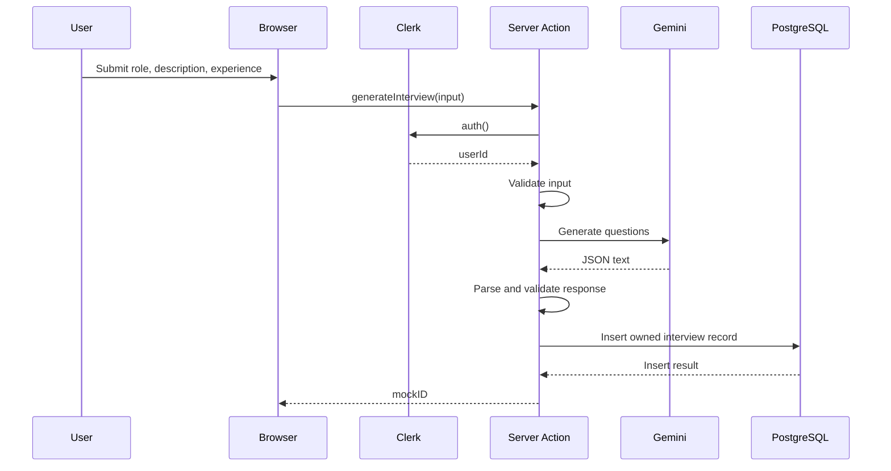

# Architecture and design

## Architectural summary

AI Interview Mocker is a Next.js App Router application. The browser renders the sign-in and dashboard interface. Clerk supplies identity. A server action validates the submitted role details, calls the Gemini provider, validates the generated JSON, and persists the result through Drizzle to PostgreSQL.

The current architecture is intentionally small. It does not yet include a separate API service, background job queue, interview-session service, evaluation pipeline, or analytics service.

## Component map

| Component | File or directory | Responsibility |
|---|---|---|
| Root layout | `app/layout.js` | Global document, styles, Clerk provider |
| Authentication pages | `app/(auth)/` | Clerk sign-in and sign-up UI |
| Route protection | `middleware.js` | Protects configured private route patterns |
| Dashboard | `app/dashboard/page.jsx` | Authenticated dashboard entry point |
| Dashboard layout | `app/dashboard/layout.jsx` | Shared dashboard shell |
| Interview form | `app/dashboard/_components/AddNewInterview.jsx` | Browser form state and submission |
| Generation action | `app/dashboard/actions.js` | Auth check, validation, AI request, persistence |
| Validation helpers | `lib/interview-validation.js` | Pure input and response validation |
| Database client | `lib/db.js` | Server-only Neon/Drizzle client |
| AI client | `utils/GeminiAiModel.js` | Server-only Gemini model setup |
| Data schema | `utils/schema.js` | Drizzle PostgreSQL table definition |
| UI primitives | `components/ui/` | Reusable Radix-based controls |
| Tests | `test/` | Node.js unit tests |

## Request sequence

## Security boundaries

### Browser boundary

The browser is untrusted. Browser-side required fields and maximum lengths improve user experience but do not replace server validation. Do not send owner identity from the browser.

### Authentication boundary

The server action obtains the current Clerk user ID using the server-side Clerk API. The authenticated identity is written to `createdBy`.

### AI provider boundary

The Gemini API key remains server-side. The model response is untrusted text. The application parses it and checks required fields before storing it.

### Database boundary

The database client is marked server-only. Every future read or mutation must include an ownership condition. A random-looking `mockID` is an identifier, not authorization.

## Design constraints

- Keep client components limited to UI and browser interaction.
- Keep privileged work in server actions or server-side modules.
- Keep pure validation functions independent from provider SDKs.
- Keep the database schema as the source of truth for persistence.
- Document schema and environment changes alongside code changes.
- Avoid storing or logging more user content than the product needs.

## Known architectural gaps

There is no interview session route, answer submission service, scoring pipeline, history query, retention workflow, background queue, or provider retry policy. See [Known limitations](known-limitations.md) and [Roadmap](../ROADMAP.md).
